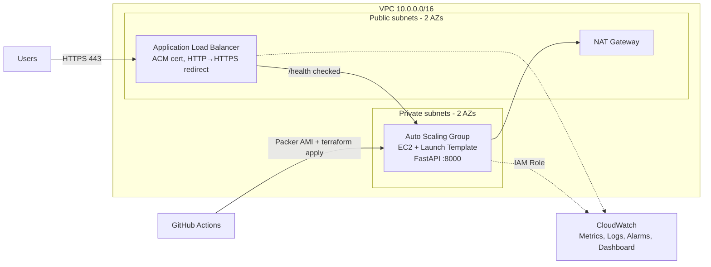

# AWS Auto-Scaling Web App with Load Balancer

A highly available FastAPI service on AWS: **ALB (HTTPS) → Auto Scaling Group across 2 AZs**, defined entirely in **Terraform**, with **zero-downtime rolling deployments**, **CloudWatch dashboards & alarms**, and a **GitHub Actions** pipeline that bakes a golden AMI with **Packer**.

## Architecture



## Repo layout

| Path | Purpose |
|---|---|
| `app/` | FastAPI app (`/`, `/health`, `/cpu`) + unit tests |
| `packer/` | Golden AMI template (Amazon Linux 2023) |
| `terraform/` | Root config + modules: `vpc`, `alb`, `asg`, `monitoring` |
| `.github/workflows/ci.yml` | test → validate → build AMI → apply → integration test |
| `tests/` | Integration tests against the live ALB URL |
| `scripts/` | Remote-state bootstrap, instance-refresh waiter, load test |
| `slides/` | Presentation deck |

## Quick start

```bash
# 1. Run the app locally
cd app && pip install -r requirements.txt && pytest -q
uvicorn main:app --reload

# 2. (Optional, once) remote state with locking
./scripts/bootstrap_state.sh my-unique-tfstate-bucket   # then uncomment backend in terraform/versions.tf

# 3. Deploy infra (lab mode: self-signed cert, stock AMI + user-data)
cd terraform
cp terraform.tfvars.example terraform.tfvars
terraform init && terraform apply
terraform output app_url        # https://<alb-dns>

# 4. Golden-AMI deploy
cd ../packer && packer init . && packer build -var app_version=1.1.0 .
cd ../terraform && terraform apply -var ami_id=ami-xxxx -var app_version=1.1.0
```

For a real certificate set `domain_name` and `route53_zone_id`; Terraform requests and DNS-validates an **ACM** cert and creates the alias record.

## Scaling behavior

| Policy | Target | Effect |
|---|---|---|
| Target tracking: `ASGAverageCPUUtilization` | 60% | Scales out above, in below (AWS manages the alarms) |
| Target tracking: `ALBRequestCountPerTarget` | 500 req/target | Scales on traffic, not just CPU |
| Bounds | min 2 / max 6 | min 2 keeps one instance per AZ |

Target tracking is the modern equivalent of the "70% out / 30% in" step policy and avoids flapping. Swap in `StepScaling` policies if you need explicit thresholds.

Test it: `./scripts/load_test.sh https://<alb-dns>` then watch **ASG Desired vs In-Service** on the dashboard.

## Zero-downtime rolling deployments

1. A new AMI / `app_version` creates a **new launch template version**.
2. The ASG's `instance_refresh` (`Rolling`, `min_healthy_percentage=100`, `max_healthy_percentage=200`) launches new instances **before** terminating old ones.
3. New instances only receive traffic after passing the ALB `/health` check (`health_check_type = "ELB"`, 120s grace, 90s warmup).
4. Old instances drain connections for 30s (`deregistration_delay`).
5. The pipeline waits on `describe-instance-refreshes` and runs integration tests that assert **all instances serve the new version**.

Rollback: re-apply with the previous AMI id (or enable `auto_rollback` + alarms on the refresh).

## Monitoring

- **Dashboard** (`modules/monitoring/dashboard.json.tpl`): request count, 4xx/5xx, p95 latency, healthy/unhealthy hosts, ASG CPU, desired vs in-service capacity.
- **Alarms** → SNS (email): ALB target 5xx, ASG CPU > 80%, unhealthy hosts.
- **Instances** ship memory metrics and system logs via the CloudWatch agent using an IAM role.

## Security

- Instances in **private subnets**; SG only allows port 8000 **from the ALB SG**.
- **IAM instance profile** (CloudWatch agent + SSM), no static keys; **IMDSv2** required; SSM Session Manager instead of SSH.
- TLS 1.3 policy on the ALB, HTTP → HTTPS redirect.
- GitHub → AWS via **OIDC role** (`AWS_ROLE_ARN` secret), no long-lived credentials.

## Cost note

NAT gateway + ALB + 2×t3.micro cost a few dollars/day. Run `terraform destroy` when done.

## Interview talking points

HA via ALB + multi-AZ ASG · target-tracking vs step scaling · instance refresh vs blue/green (two ASGs + Route 53 weighted records) · S3/DynamoDB state locking · IAM roles/OIDC over keys · warmup, grace period and connection draining · Spot via mixed instances policy.
